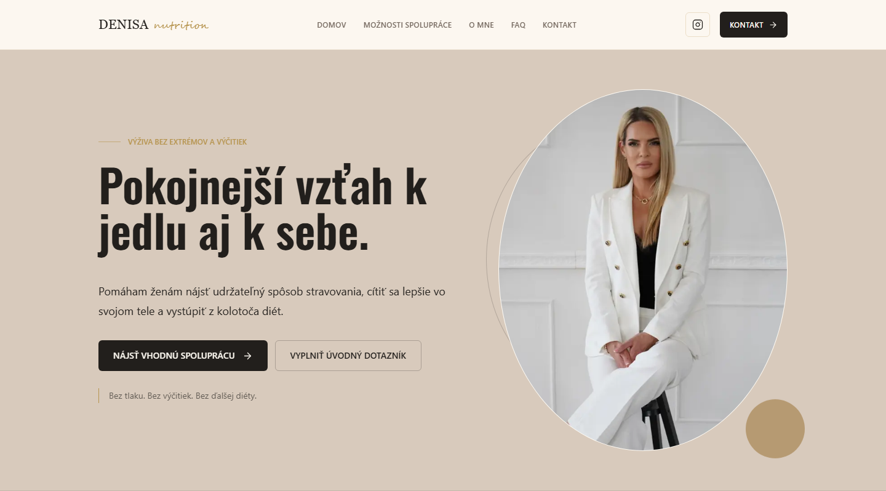

# Richard Kotrha

Web developer in Prague with hands-on IT experience from client and personal projects.
I'm interested in technical support, troubleshooting, software and automation.

[richard@kotrha.cz](mailto:richard@kotrha.cz) · [kotrha.cz](https://kotrha.cz) · Prague, Czech Republic

---

## About me

I work as an independent developer, so on client projects I look after the whole lifecycle myself: understanding what the client needs, building it, deploying it, and supporting it once real people start using it. Most of what I know about IT comes from that last part — finding out why something doesn't work and getting it working again.

In practice, that has meant:

- **Troubleshooting across the whole stack** — browser, API, database, email delivery and hosting configuration — and adding tests so that a fixed bug stays fixed.
- **Writing help content for non-technical users** — for example, a help-centre knowledge base for the HR users of a booking platform: step-by-step guides, a table of error messages with the cause and fix for each one, checks for emails that don't arrive, and clear rules for when to escalate to support.
- **Working directly with clients** — turning a description of a problem into concrete changes, and explaining options, limits and costs in plain language.
- **Running production services** — environment configuration, deployments, databases and transactional email on Vercel, Netlify, Neon and Resend.
- **Learning by building** — personal projects are where I try new things, such as a small issue tracker in Python and an investment research pipeline built on public data APIs.

I use AI coding assistants (Claude Code, Codex) for much of the implementation work, and I stay responsible for the result: I make the technical decisions, review and test the changes — on preview deployments with separate test databases where it matters — and decide what goes to production and when.

---

## Selected projects

### Denisa Nutrition

Website for a nutrition coach

**Status:** Live · **Type:** Client project · **Code:** Private

A Slovak-language website that presents a nutrition coach's services and approach, and guides visitors towards a first consultation — through a contact form or a structured intake questionnaire that arrives in the coach's inbox before the first meeting.

- Six pages: home, about, services with detail views, FAQ, contact and an intake questionnaire
- Contact form and an 8-question intake questionnaire, both handled by server-side API routes
- Server-side validation, input length limits, HTML escaping and a hidden honeypot field against spam bots
- Submissions delivered as formatted emails via Resend, with reply-to set to the sender so the coach can answer directly
- Responsive layout for mobile and desktop; the API routes run as serverless functions on Netlify

**Built with:** Next.js (App Router), React, TypeScript, Tailwind CSS, Resend, Netlify

**Live:** [denisa-nutrition.netlify.app](https://denisa-nutrition.netlify.app/)

### Pausitive

Booking and administration platform for corporate massages

**Status:** In production, actively developed · **Type:** Client project · **Code:** Private

Pausitive sends massage therapists to companies' offices and other workplaces. Next to its public website, the platform runs the whole booking process for these visits: a company's HR contact requests dates, an administrator approves them, and employees choose their own time slots through a shared link.

- Three kinds of users — administrator, HR manager and employees — with role checks and rate limiting on the server; accounts use email verification and password reset
- Booking logic: requests for one or more days, admin approval, and automatic time-slot generation from the number of therapists, massage length, working hours and lunch breaks
- Employee self-service through a secure link: book or cancel a slot, receive a calendar invite (.ics), or join a waitlist
- Change requests from HR (times, lunch breaks, extra days, cancellations) go to the administrator for approval
- Automated emails for every step via Resend, and export of the schedule to Excel
- Automated tests for the trickiest logic: waitlist cut-offs, time zones and daylight saving time, calendar invites and access rules

**AI support assistant (in production, admin-only).** A chat assistant in the HR area that answers "how do I…?" and "why can't I…?" questions from the help-centre knowledge base described above, and can forward the conversation to human support by email. It is deployed in production, but access is currently restricted to administrator accounts; HR users don't have it yet. It has no access to customer data and is rate-limited.

**Built with:** Next.js, React, TypeScript, Tailwind CSS, PostgreSQL (Neon), Prisma, Better Auth, Resend, Claude API, Vercel

**Live:** [pausitive.sk](https://www.pausitive.sk) — the public website; the booking area requires an account

### Personal Investment Agent

Research automation for a long-term stock watchlist

**Status:** Work in progress · **Type:** Personal project · **Code:** Private

An experiment in automating the routine part of following a stock watchlist: each day it collects data from several public sources and condenses it into one email that points out what may deserve a closer look. It is a research aid only — it does not trade or connect to any brokerage account.

**Working today**

- A daily job for a configurable watchlist of US stocks, run on demand or on a schedule
- Collects end-of-day prices (Tiingo), recent SEC filings (EDGAR) and news (GDELT), and stores them in PostgreSQL
- Rule-based scoring of filings and news; every flagged item lists its reasons and its caveats
- Optional AI summary (OpenAI API) for the highest-scoring items, compared against my own written investment notes; items seen before are reused instead of being analysed again
- A daily email report via Resend; API rate limits are handled so that one failing source doesn't stop the run

**In progress (started, not finished)**

- Validating my own research data before the job is allowed to use it
- Separate database accounts with minimal permissions for the daily job and for schema changes
- Automated tests and a CI pipeline — partly written, not yet complete or running

**Not done yet**

- Testing those database permissions against a real PostgreSQL server
- A user interface — it runs from the command line
- Deployment — it runs only on my own computer and is not ready for production use

**Built with:** Node.js, TypeScript, PostgreSQL, Prisma, OpenAI API, Resend

### Learning project

**secure-issue-hub** · **Code:** Private — the back end of a small issue tracker, built to learn Python and back-end security basics: workspaces, role-based access (owner, developer, security reviewer), session authentication with CSRF protection, Argon2 password hashing, issue comments and an audit log. FastAPI, SQLAlchemy, Alembic and PostgreSQL, with a minimal plain-JavaScript front end.

---

## A few problems I've tracked down

Examples from my client and personal projects.

- **"I can't sign in" on a test environment.** The logs showed "User not found": the preview deployment correctly used a separate, empty test database, so production accounts didn't exist there, and registering a test account solved it. While tracing the sign-in flow, I also found that email-verification and password-reset links on these deployments pointed to a host that didn't exist. Fix: build the links from the deployment's own URL, trust only that exact deployment as an origin (no wildcards), and cover both cases with tests.
- **Time slots that "reopened" after the clock change.** Waitlist eligibility compared local clock times, so during the repeated hour at the end of daylight saving time, a slot that had already started could look available again. Fix: compare real points in time (UTC) instead of clock times, and add regression tests around the daylight-saving transitions.
- **A form that broke only on iPhone.** In a personal fitness-tracking web app, the date field in Safari on iOS rendered wider than its column and pushed the form out of line, while desktop browsers looked fine. Fix: allow the form fields to shrink inside the grid (`min-width: 0`) and constrain Safari's internal date element.

---

## Technologies & tools

| Area | Used in the projects above |
| --- | --- |
| Languages | TypeScript, JavaScript, SQL, HTML, CSS |
| Web & back end | Next.js, React, Node.js, Tailwind CSS |
| Data | PostgreSQL, Prisma, Neon |
| Services & APIs | Resend (transactional email), Better Auth, REST APIs, Claude API, OpenAI API |
| Hosting & tools | Vercel, Netlify, Git, GitHub |
| Testing | Node.js test runner |
| AI coding tools | Claude Code, Codex |
| Currently learning | Python and FastAPI (the issue-tracker project above) |

---

## Contact

- **Email:** [richard@kotrha.cz](mailto:richard@kotrha.cz)
- **Website:** [kotrha.cz](https://kotrha.cz)
- **GitHub:** [github.com/Riso159](https://github.com/Riso159)
- **Location:** Prague, Czech Republic

Most of the code described above is private — it is client work or a personal project. I'm happy to walk through any of it in more detail.
